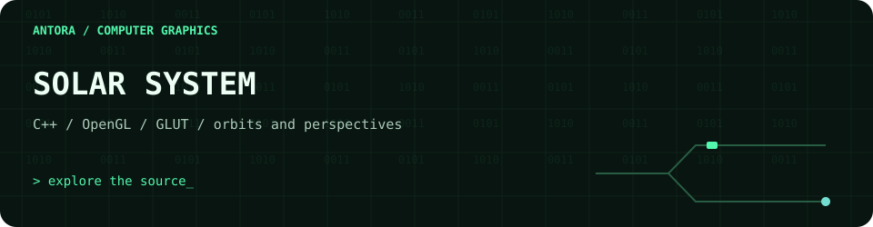

<!-- antora-terminal:start -->

  

Decorative SVG motion · matching Antora developer workspace theme · reduced-motion support
<!-- antora-terminal:end -->

# Solar System Simulation

A C++ graphics project using OpenGL and GLUT. `main.cpp` includes planet perspectives, orbit rendering, star fields, a Bézier comet path, DDA lines and midpoint circles.

Review `main.cpp` and the Code::Blocks project configuration for the required local OpenGL/GLUT toolchain.
