<!-- antora-terminal:start -->
<picture>
  <source media="(prefers-reduced-motion: reduce) and (max-width: 600px)" srcset=".github/antora/workflow-mobile-still.svg">
  <source media="(prefers-reduced-motion: reduce)" srcset=".github/antora/workflow-still.svg">
  <source media="(max-width: 600px)" srcset=".github/antora/workflow-mobile.svg">
  
</picture>
Illustrative motion / responsive layout / reduced-motion alternatives
<!-- antora-terminal:end -->

# Solar System Simulation

A C++ graphics project using OpenGL and GLUT. `main.cpp` includes planet perspectives, orbit rendering, star fields, a Bézier comet path, DDA lines and midpoint circles.

Review `main.cpp` and the Code::Blocks project configuration for the required local OpenGL/GLUT toolchain.
